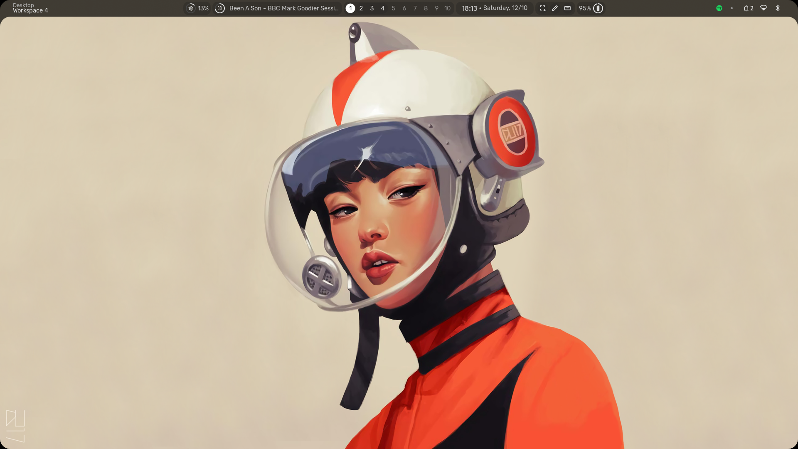
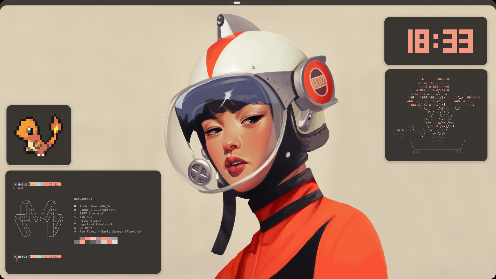
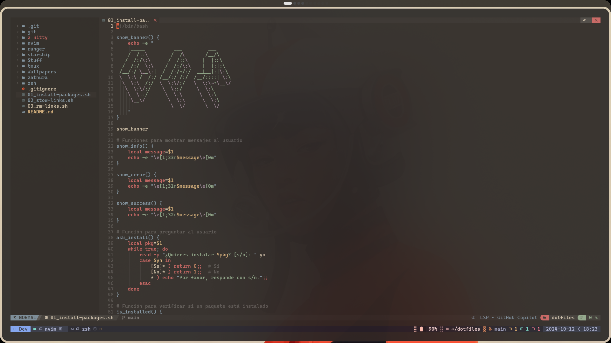
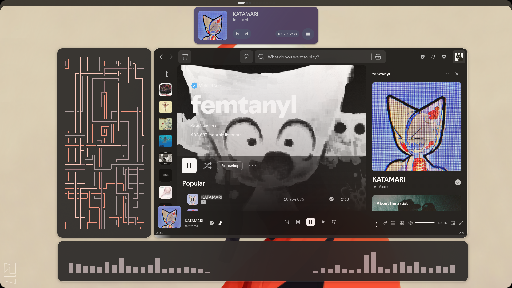
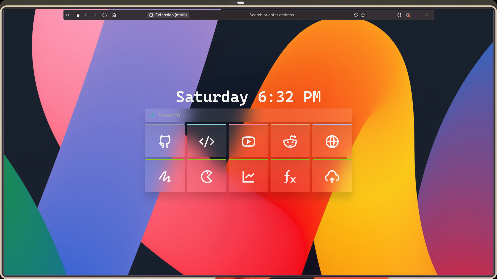
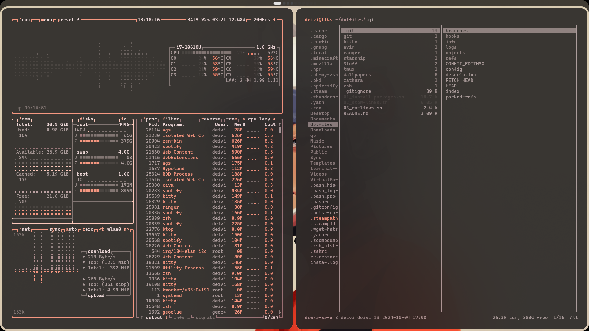
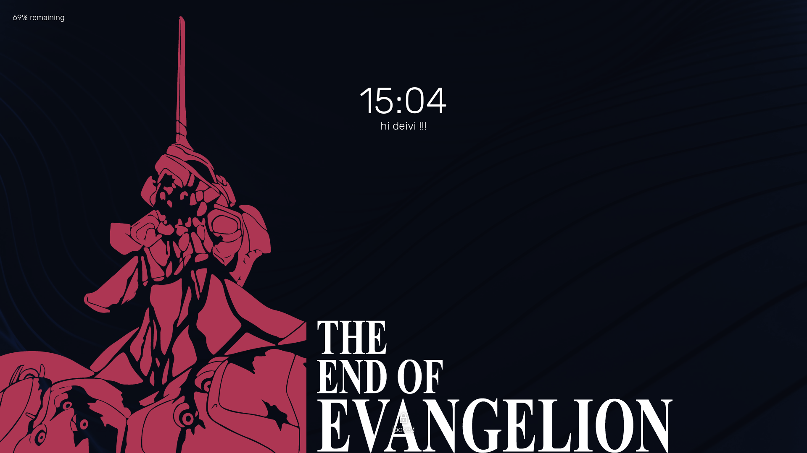

# Dotfiles para Arch Linux y Hyprland

Configuraciones de mi entorno de trabajo en Linux. La configuración visual de Hyprland parte de [end-4/dots-hyprland](https://github.com/end-4/dots-hyprland). Este repositorio añade mis configuraciones para herramientas como Kitty, tmux, Zsh y Neovim, junto con scripts para preparar el entorno.

## Probar una configuración

El ejemplo requiere Git, GNU Stow y Kitty. La configuración de Kitty usa JetBrainsMono Nerd Font.

```bash
git clone https://github.com/Deivis44/dotfiles.git
cd dotfiles
mkdir -p "$HOME/.config/kitty"
stow --dir=Config --target="$HOME" --simulate --verbose kitty
```

Si la simulación muestra un conflicto, guarda una copia del archivo existente antes de moverlo. Para aplicar el cambio, repite el comando sin `--simulate`. Para quitar los enlaces creados por Stow, ejecuta `stow --dir=Config --target="$HOME" --delete kitty` desde el repositorio.

## Scripts

- [`Scripts/stow-links.sh`](Scripts/stow-links.sh) lee las configuraciones desde `~/dotfiles/Config`, pide confirmación por destino y crea enlaces con `ln -s`. Mueve los destinos existentes a una copia de respaldo cuando son archivos o directorios y reemplaza los enlaces simbólicos existentes.
- [`Scripts/Full_Install.sh`](Scripts/Full_Install.sh) es el instalador interactivo. Puede ejecutar el instalador de end-4, instalar paquetes y lanzar scripts adicionales. Usa `~/dotfiles` para localizar los archivos y `~/Downloads` para el registro.

## Screenshots









### Personal Setup

- **Browser**: Zen (Alpha) + Home tab extension (mtab)
- **Monospace font**: CaskaydiaCove Nerd Font Mono
- **Terminal**: Kitty
- **Editor**: Nvim Chad (+ Tmux)
- **Music**: Spotify + Spicetify personalization layer
- **Wallpaper**: [Rocket_girl](https://mega.nz/file/3lxDWIrR#Lt53rC6Y52ZjJRAejbyBqpG6eGpu577yPOfovJCAd0o)
- **My wallpaper collection**: [Wallpapers](https://mega.nz/folder/P5pygYZQ#u-x2WmRNMVpWEt8u2Xo5fQ)
- **Stickers**: [.png & .ai files](https://github.com/Deivis44/dotfiles/tree/main/Resources/Stickers)

***
